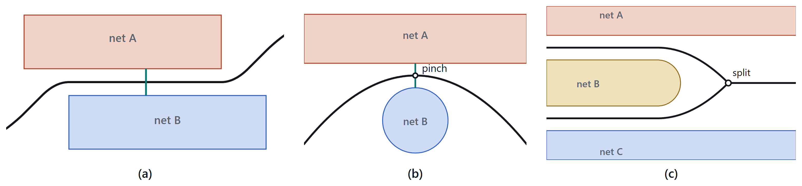
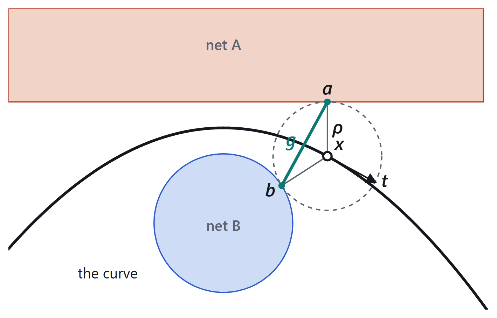
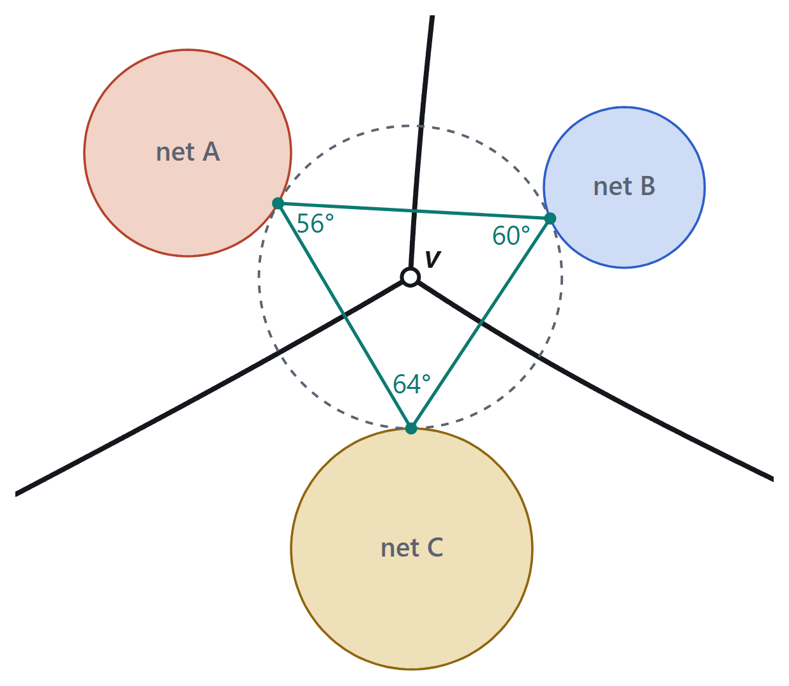
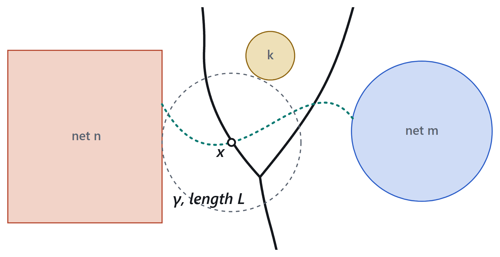
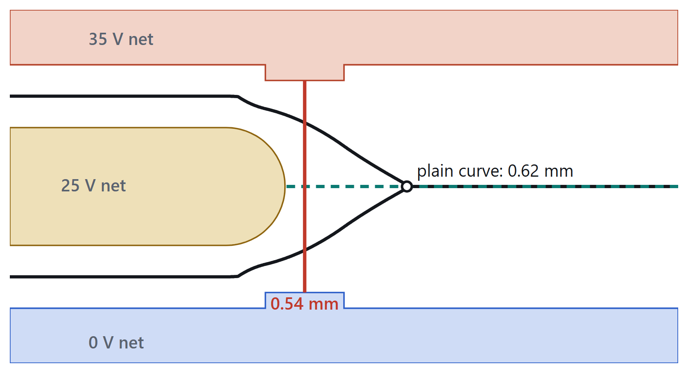
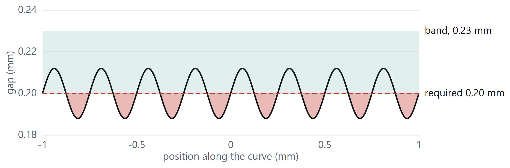
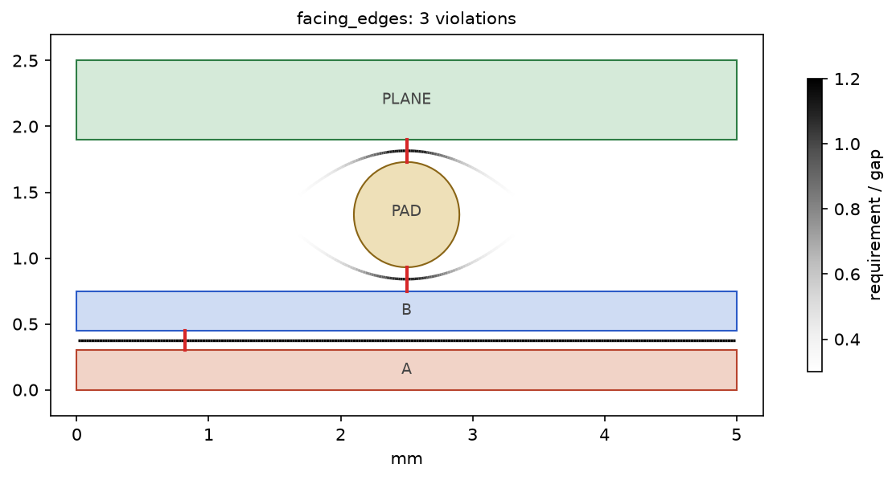
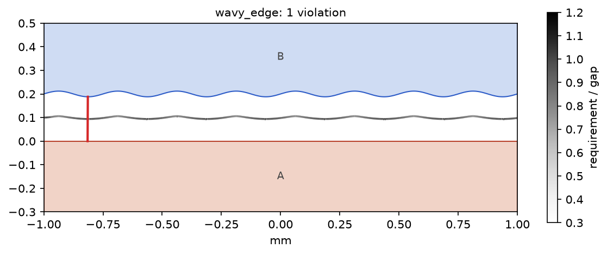
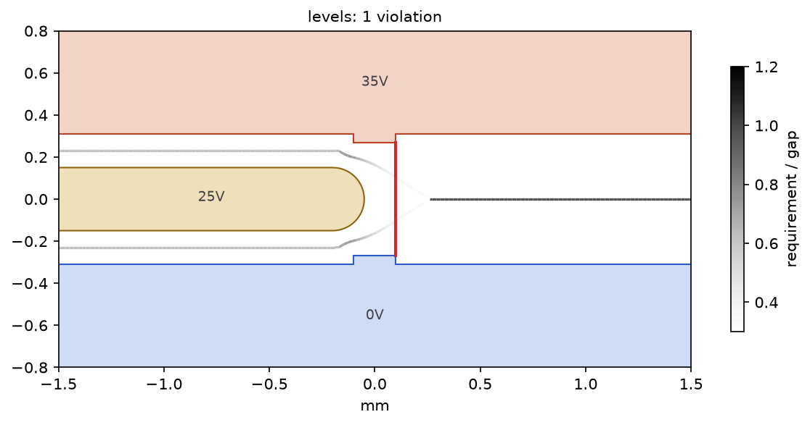
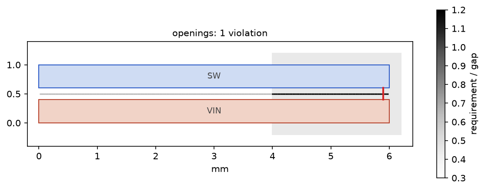

# Voronoi-Delaunay Clearance Algorithm

Finds every gap between two conductors that is closer than its requirement, and only those, by walking the
**clearance curve**: the set of points equally near two different conductors. On a printed board the conductors are
the copper of each net; the requirement can be one value, or grow with the voltage between the two nets and with the
surface they sit on.

The curve is the Voronoi diagram of the copper outlines. It is computed from the Delaunay triangulation of points
sampled along every outline, in O(n log n) time for n samples, and every gap on it is a clear straight line between
two nets.

```python
from shapely.geometry import box
from clearance_curve import check

for v in check({"A": box(0, 0, 5, 0.3), "B": box(0, 0.45, 5, 0.75)}, requirement=0.2):
    print(v.net_a, v.net_b, round(v.gap, 3), v.required)      # A B 0.15 0.2
```

## Install

```bash
pip install git+https://github.com/Nezv/Voronoi-Delaunay-Clearance-Algorithm
```

It needs Python 3.9 or later, numpy, scipy and shapely 2. The figures in the examples also need matplotlib
(`pip install "voronoi-delaunay-clearance[plot]"` from a clone).

## The clearance curve

### 1 Definition

For a point $x$ in air, let $d_n(x)$ be its distance to the copper $C_n$ of net $n$, and $d_1 \le d_2$ the two
smallest such distances. The clearance curve $S$ is where they are equal (Fig. 1), and $\sigma$ is the shortest
net-to-net path through $x$.

$$S = \lbrace x : d_1(x) = d_2(x) \rbrace, \qquad d_n(x) = \min_{a \in C_n} \lVert x - a \rVert \tag{1}$$

$$\sigma(x) = d_1(x) + d_2(x) \tag{2}$$



*Figure 1. The curve (black) between facing edges (a), a round pad (b) and a third net (c); the gap in green.*

### 2 Local gap

At $x \in S$ the largest empty circle, of radius $\rho$, touches both nets at foot points $a$ and $b$ (Fig. 2). The
chord $g = \lVert a - b \rVert$ is a clear gap, perpendicular to the curve. With $\alpha$ the angle between the curve
and the radius to $a$:

$$\frac{d\rho}{ds} = \cos\alpha, \qquad g = 2\rho\sin\alpha \tag{3}$$

$$\left(\frac{d\rho}{ds}\right)^2 + \left(\frac{g}{2\rho}\right)^2 = 1 \tag{4}$$

The narrowest gaps are the stationary points of $\rho$:

$$\frac{d\rho}{ds} = 0 \iff g = 2\rho \tag{5}$$



*Figure 2. Empty circle at $x$: foot points $a$, $b$ and chord $g$.*

### 3 Splits

Where three nets are equidistant, the curve splits at the circumcentre $v$ of the foot triangle (Fig. 3). The branch
between nets $i$ and $j$, opposite the angle $K$ at the third foot point, carries

$$g_{ij} = 2\rho\sin K, \qquad \left(\frac{d\rho}{ds}\right)_{ij} = -\cos K \tag{6}$$

so at most one branch widens.

### 4 Completeness

Any air path $\gamma$ from net $n$ to net $m$ changes nearest net at some $x \in S$ (Fig. 4), where

$$2\rho(x) \le d_n(x) + d_m(x) \le L(\gamma) \tag{7}$$

so every gap shorter than the requirement appears on the curve.

|  |  |
|:--:|:--:|
| *Figure 3. Split at $v$ and its foot triangle.* | *Figure 4. Path $\gamma$ crossing the curve at $x$.* |

### 5 Clearance levels

If the requirement grows with voltage, a net at an intermediate voltage can hide a high-voltage gap (Fig. 5). One
curve per level $c_j$, built only between the nets that need it, with other copper as obstacles, restores
completeness. A violation is any $x$ with $U(x) > 1$:

$$U(x) = \max_j \frac{c_j}{\sigma_j(x)} \tag{8}$$



*Figure 5. Plain curve (solid) and level curve (dashed) through a 0.54 mm neck.*

### 6 Counting

A violation is a connected region $Z$ below the requirement $c$; a band $\tau$ joins oscillating gaps into one
(Fig. 6):

$$Z \subset \lbrace x : \sigma(x) < c + \tau \rbrace, \qquad Z \cap \lbrace x : \sigma(x) < c \rbrace \ne \emptyset \tag{9}$$



*Figure 6. Gap along a wavy edge: eight dips, one violation.*

### 7 Computation

Outlines are sampled every 0.02 mm; the Voronoi diagram of the samples gives $S$, each ridge's two generators being
its foot points. Each point gets its own requirement from the voltage between its nets and the surface $s$ at its
feet, in O(n log n) time for n samples:

$$c(x) = \max\left(c_{min},\ c_{IPC}(\Delta V, s)\right) \tag{10}$$

In this package:

1. **Samples.** Every net's outline is sampled every `step` (default 0.02 mm). Samples that coincide are kept once.
2. **Curve.** The samples are triangulated (Delaunay). A triangle edge whose ends lie on two different nets is a
   ridge: its dual Voronoi edge, between the circumcentres of its two triangles, is a piece of $S$, and its two ends
   are the foot points $a$, $b$ of the gap $g$ across it. The triangulation is built once; any number of
   requirements can be checked against it.
3. **Requirement.** Each ridge takes the requirement of its two nets, or the bare requirement when a foot point lies
   in an opening (where the surface $s$ is bare copper rather than coated).
4. **Zones.** Ridges under the requirement are joined through shared triangles while they stay within the band
   $\tau$ (section 6). Each zone is one violation, given at its largest $U = c/g$.
5. **Levels.** When the requirement is not one value, each sample of a net that may need more than the smallest
   requirement searches for other nets within its largest requirement (a k-d tree). A pair closer than its
   requirement is a violation when the straight gap crosses no other copper and the curve doesn't already show that
   pair nearby (section 5).

Sampling makes every gap exact to within the sampling error of the outlines: a straight edge is exact, an arc of
radius $r$ sampled every $h$ is off by at most $h^2/(8r)$.

## Use

```python
from clearance_curve import ClearanceCurve

curve = ClearanceCurve(nets, step=0.02, openings=None)    # nets: {name: shapely geometry}
violations = curve.check(requirement, bare_requirement=None, tau=0.02)
gaps = curve.gaps(threshold=1.0)
segments, g = curve.edges()                                # the curve itself, for drawing
u = curve.ratio(requirement)                               # U = c / g on each segment
```

- `nets` maps a net name to its copper on one layer: shapely polygons (lines and points work too). Units are yours;
  the defaults assume millimetres.
- `requirement` is one number for every pair, or a function `(net_a, net_b) -> number`, called once per pair.
- `openings` is where copper is bare (for example solder mask openings); gaps with a foot point inside it use
  `bare_requirement`.
- `tau` is the band of section 6.
- `check(nets, requirement, ...)` builds the curve and checks it in one call.

A `Violation` has `net_a`, `net_b` (in name order), `gap`, `required`, `ratio` ($U = c/g$), the foot points `foot_a`
and `foot_b`, `method` (`"curve"`, or `"level"` for the search of section 5), the `length` of curve it covers, its
bounding `box` and whether it is `bare`. Violations come worst first.

A `Gap` is the narrowest point of one stretch of curve between two nets, violation or not.

## Examples

Each example is a script in [examples](examples); run it from the repository root with
`PYTHONPATH=. python examples/<name>.py`. `python examples/plot.py` draws all four into [docs/examples](docs/examples):
the nets, the curve shaded by $U = c/g$, and each violation's gap in red.

### Facing edges, a pad and a plane

Two traces 0.15 mm apart, and a round pad 0.18 mm from one trace and 0.17 mm from a plane, all needing 0.2 mm
([facing_edges.py](examples/facing_edges.py)):

```python
nets = {
    "A": box(0, 0, 5, 0.3),
    "B": box(0, 0.45, 5, 0.75),
    "PAD": Point(2.5, 1.33).buffer(0.4),
    "PLANE": box(0, 1.9, 5, 2.5),
}
for v in check(nets, requirement=0.2):
    ...
```

```
    A - B      gap 0.150 mm  needs 0.20 mm  over 4.98 mm of curve
  PAD - PLANE  gap 0.170 mm  needs 0.20 mm  over 0.34 mm of curve
    B - PAD    gap 0.180 mm  needs 0.20 mm  over 0.26 mm of curve
```



The whole 5 mm between A and B is one violation; each side of the pad is one more, at the pinch where $g = 2\rho$.

### Counting along a wavy edge

The gap swings between 0.188 and 0.212 mm against a 0.2 mm requirement, dipping under it eight times
([wavy_edge.py](examples/wavy_edge.py)). The curve is built once and checked twice:

```python
curve = ClearanceCurve(nets, step=0.005)
len(curve.check(0.2, tau=0.03))     # 1: the band joins the dips
len(curve.check(0.2, tau=0.0))      # 8
```



### A gap hidden by a net in between

A 25 V trace runs between a 35 V and a 0 V net and ends just before their 0.54 mm neck. The requirement is 0.6 mm
above 30 V and 0.1 mm below ([levels.py](examples/levels.py)):

```python
volts = {"35V": 35.0, "25V": 25.0, "0V": 0.0}
def requirement(a, b):
    return 0.6 if abs(volts[a] - volts[b]) > 30 else 0.1

curve = ClearanceCurve(nets)
curve.check(requirement)
```

```
narrowest 35V - 0V gap on the curve: 0.62 mm
0V - 35V: gap 0.54 mm, needs 0.60 mm, found by the level search
```



On the curve of all three nets the neck lies between 35 V and 25 V and between 25 V and 0 V, both of which need only
0.1 mm; the 35 V to 0 V branch starts past the trace's end, at 0.62 mm. The level search of section 5 finds the
0.54 mm gap.

### Bare copper

Two traces 0.2 mm apart need 0.13 mm under solder mask and 0.25 mm where they are bare; the right third lies in a
mask opening ([openings.py](examples/openings.py)):

```python
curve = ClearanceCurve(nets, openings=box(4, -0.2, 6.2, 1.2))
curve.check(requirement=0.13, bare_requirement=0.25)
curve.gaps(threshold=0.5)
```

```
SW - VIN: gap 0.20 mm, needs 0.25 mm, bare: True, x 3.99 to 5.99 mm
narrowest gap SW - VIN: 0.20 mm
```



## Tests

```bash
python -m unittest discover tests
```

## License

MIT, see [LICENSE](LICENSE).
